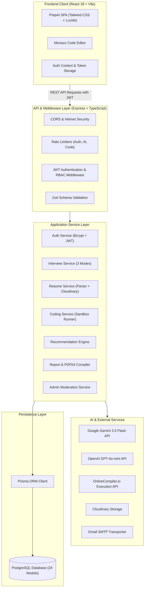

# 01 — PrepAI Project Overview & System Architecture

## 1. Executive Summary

**PrepAI** is an AI-powered technical interview preparation, coding practice, and career readiness platform designed specifically for undergraduate engineering students (B.Tech CSE, ECE, EE, and ME). The platform bridges the gap between theoretical academic curricula and the rigorous problem-solving standards demanded by Tier-1 technology companies (Google, Amazon, Microsoft, Uber, Flipkart) and campus placement drives.

The system combines:
1. **Adaptive AI Mock Interviews** driven by Google Gemini (`gemini-3.5-flash`), featuring socratic cross-examinations, dynamic follow-up questioning, multi-mode evaluation (Resume-Based, Topic-Focused, and Comprehensive), and six-dimensional rubric evaluations.
2. **AI Resume Analysis** that parses candidate PDF/DOCX resumes, extracts key skills, technologies, and projects, and contextualizes technical interview cross-examinations around the candidate's actual projects.
3. **Multi-Language Isolated Code Execution** powered by OnlineCompiler.io (with Judge0 CE compatibility), allowing real-time running, test-case verification, and metrics capture for C++, Python, Java, JavaScript, and Go.
4. **Automated Post-Interview Remediation**, dynamically recommending verified syllabus resources, GATE previous year questions (PYQs), and Striver A2Z / CP-31 coding problems based on detected evaluation gaps.
5. **AI-Synthesized Mastery Study Notes & PDF Dossiers**, compiling tailored technical revision compendiums with code snippets, algorithms, and revision checklists exportable via `pdfkit`.
6. **Administrative & Moderation Governance**, giving administrators tools to monitor AI evaluations, review candidate-flagged evaluations, manage resource requests, maintain coding problems, and analyze institutional placement trends.

---

## 2. Technology Stack Breakdown

| Layer | Technologies & Frameworks | Key Responsibilities |
|---|---|---|
| **Frontend UI** | React 18, Vite 5, TypeScript 5, Tailwind CSS 3, Lucide React, Monaco Editor | Single Page Application (SPA), responsive dashboard, interactive interview room, live code editor, radar/metric visualizations |
| **Backend API** | Node.js (v20+), Express 4, TypeScript 5, Zod | RESTful API, authentication & session lifecycle, request validation, AI orchestration, PDF generation |
| **Database & ORM** | PostgreSQL 15+, Prisma ORM 5.22 | Relational data persistence, foreign key constraints, connection pooling, schema migrations, and idempotent database seeding |
| **Primary AI Engine** | Google Gemini (`@google/generative-ai`), `gemini-3.5-flash` / `gemini-3.1-flash-lite` | Real-time question generation, verbal answer evaluation, follow-up probe synthesis, resume extraction, study notes generation |
| **Secondary AI Engine** | OpenAI (`openai`), `gpt-4o-mini` | Secondary report polishing, multi-week roadmap formatting (with seamless automatic fallback to Gemini) |
| **Code Execution** | OnlineCompiler.io REST API (with Judge0 CE compatibility) | Multi-language sandboxed code compilation, sample testing, and multi-test-case judging |
| **File Storage** | Cloudinary API, Multer (in-memory buffer storage) | Secure cloud upload for candidate resumes and study attachments |
| **Email Service** | Nodemailer, Gmail SMTP (Port 587, STARTTLS) | Email verification, password reset tokens, and notifications |
| **Document Processing** | `pdfkit`, `pdf-parse`, `mammoth` | Server-side PDF report compilation, PDF resume text extraction, DOCX parsing |

---

## 3. High-Level System Architecture Diagram



---

## 4. Complete Repository Directory Tree

```
c:/major-project/
├── backend/                                   # Express + TypeScript + Prisma Backend
│   ├── prisma/
│   │   ├── schema.prisma                      # 24 Models, 8 Enums, Relations & Indexes
│   │   ├── seed.ts                            # Idempotent master database seeder
│   │   └── seedData/                          # Structured seed datasets
│   │       ├── companiesAndQuestions.ts       # Top tech companies & real interview questions
│   │       ├── cp31.ts                        # CP-31 Sheet competitive programming benchmarks
│   │       ├── preparationResources.ts        # GATE PYQs, VLSI notes, Core CS cheat sheets
│   │       └── striverA2Z.ts                  # Striver A2Z DSA sheet problem collection
│   ├── src/
│   │   ├── app.ts                             # Express app configuration & middleware pipeline
│   │   ├── server.ts                          # Server bootstrap, DB connect & graceful shutdown
│   │   ├── config/
│   │   │   ├── cloudinary.ts                  # Cloudinary v2 SDK configuration
│   │   │   ├── database.ts                    # PrismaClient singleton instance
│   │   │   ├── email.ts                       # Nodemailer transporter & verify() logic
│   │   │   └── env.ts                         # Environment variable parser & validation
│   │   ├── controllers/                       # 11 Express controllers
│   │   │   ├── admin.controller.ts
│   │   │   ├── auth.controller.ts
│   │   │   ├── bookmark.controller.ts
│   │   │   ├── coding.controller.ts
│   │   │   ├── companyQuestion.controller.ts
│   │   │   ├── dashboard.controller.ts
│   │   │   ├── interview.controller.ts
│   │   │   ├── profile.controller.ts
│   │   │   ├── resource.controller.ts
│   │   │   ├── resume.controller.ts
│   │   │   └── settings.controller.ts
│   │   ├── middleware/                        # 6 Express middleware modules
│   │   │   ├── auth.ts                        # JWT verification & request user hydration
│   │   │   ├── authorize.ts                   # Role-Based Access Control (RBAC) guard
│   │   │   ├── errorHandler.ts                # Centralized AppError & Prisma exception handler
│   │   │   ├── rateLimiter.ts                 # Express rate limiters (Auth, AI, Code, General)
│   │   │   ├── upload.ts                      # Multer memory storage (5MB PDF/DOCX filter)
│   │   │   └── validate.ts                    # Generic Zod validation middleware
│   │   ├── routes/                            # 11 Modular route definitions
│   │   │   ├── admin.routes.ts
│   │   │   ├── auth.routes.ts
│   │   │   ├── bookmark.routes.ts
│   │   │   ├── coding.routes.ts
│   │   │   ├── companyQuestion.routes.ts
│   │   │   ├── dashboard.routes.ts
│   │   │   ├── interview.routes.ts
│   │   │   ├── profile.routes.ts
│   │   │   ├── resource.routes.ts
│   │   │   ├── resume.routes.ts
│   │   │   └── settings.routes.ts
│   │   ├── services/                          # Business logic layer
│   │   │   ├── admin.service.ts
│   │   │   ├── analytics.service.ts
│   │   │   ├── auth.service.ts
│   │   │   ├── bookmark.service.ts
│   │   │   ├── codeExecution.service.ts       # OnlineCompiler.io & Judge0 execution adapter
│   │   │   ├── coding.service.ts              # Problem listing, judging, user progress
│   │   │   ├── companyQuestion.service.ts
│   │   │   ├── interview.service.ts           # Session generation, answer upsert, completion
│   │   │   ├── profile.service.ts
│   │   │   ├── recommendation.service.ts      # Gap-based recommendation mapper
│   │   │   ├── report.service.ts              # PDFKit compiler & Gemini study notes synthesis
│   │   │   ├── resource.service.ts
│   │   │   ├── resume.service.ts              # PDF/DOCX parser & Cloudinary uploader
│   │   │   ├── settings.service.ts
│   │   │   └── ai/                            # AI Provider implementations
│   │   │       ├── aiProvider.ts              # Provider interface & Zod schemas
│   │   │       ├── geminiProvider.ts          # Google Generative AI integration with timeout
│   │   │       └── openaiProvider.ts          # OpenAI report polishing with graceful fallback
│   │   ├── utils/                             # Shared utility functions
│   │   │   ├── email.ts                       # HTML email templates (Verify, Reset password)
│   │   │   ├── errors.ts                      # Custom HTTP Error hierarchy
│   │   │   ├── jwt.ts                         # Token sign/verify & SHA-256 hash generator
│   │   │   └── password.ts                    # Bcrypt hash and compare functions
│   │   └── validators/                        # Zod schema definitions
│   │       ├── auth.validators.ts
│   │       ├── coding.validators.ts
│   │       ├── content.validators.ts
│   │       ├── interview.validators.ts
│   │       └── user.validators.ts
│   └── tests/                                 # Unit & Integration tests
│       ├── api.test.ts                        # Core API, auth, and error tests
│       ├── coding.test.ts                     # Code execution & judge tests
│       ├── interview.test.ts                  # Mock interview orchestration tests
│       └── e2e-interview-audit.ts             # Complete candidate end-to-end integration test
├── frontend/stitch_ai_technical_interview_platform/ # React 18 + Vite SPA Frontend
│   ├── public/
│   │   └── _redirects                         # SPA route rewrite rule for static hosting
│   ├── src/
│   │   ├── App.tsx                            # Root application component with Providers
│   │   ├── main.tsx                           # React 18 DOM mount entry point
│   │   ├── index.css                          # Tailwind CSS custom styles and themes
│   │   ├── components/
│   │   │   ├── auth/                          # AuthInput, AuthSelect, ProtectedRoute, etc.
│   │   │   ├── coding/                        # MonacoCodeEditor.tsx
│   │   │   ├── common/                        # Toast.tsx, QuickFindModal.tsx
│   │   │   └── layout/                        # UserShell.tsx, AdminShell.tsx
│   │   ├── context/
│   │   │   ├── AuthContext.tsx                # Authentication state, login, logout, refresh
│   │   │   └── AppContext.tsx                 # Global profile, bookmarks, interview config
│   │   ├── pages/                             # 18 Application screens
│   │   │   ├── auth/                          # Login, Register, Forgot, Reset, Verify
│   │   │   ├── AdminDashboard.tsx             # Comprehensive admin management center
│   │   │   ├── AIMockInterviewSetup.tsx       # 3-Mode interview configuration & blueprint
│   │   │   ├── AnalyticsDashboard.tsx         # Performance analytics, radar chart, history
│   │   │   ├── Bookmarks.tsx                  # Saved problems, questions, resources
│   │   │   ├── CodingPractice.tsx             # Monaco IDE, test cases, code execution
│   │   │   ├── CompanyQuestions.tsx           # Company directory and interview archive
│   │   │   ├── InterviewHistory.tsx           # Past sessions, score trends, PDF downloads
│   │   │   ├── LandingPage.tsx                # Hero section, feature walkthrough, CTA
│   │   │   ├── LiveAIInterviewRoom.tsx        # Verbal interview workspace, rubric, study dossier
│   │   │   ├── PreparationResources.tsx       # GATE PYQs, cheat sheets, upvoting
│   │   │   ├── ResumeAnalyzer.tsx             # PDF/DOCX drag & drop, skill extraction
│   │   │   ├── Settings.tsx                   # Security, active sessions, preferences
│   │   │   ├── UserDashboard.tsx              # Student home, quick stats, recommended tasks
│   │   │   └── UserProfile.tsx                # Academic details, branch/semester editor
│   │   ├── routes/
│   │   │   └── AppRoutes.tsx                  # React Router v6 route configuration
│   │   ├── services/                          # Frontend API integration service layer
│   │   │   ├── adminService.ts
│   │   │   ├── analyticsService.ts
│   │   │   ├── api.ts                         # Fetch wrapper with auto token refresh
│   │   │   ├── authService.ts
│   │   │   ├── bookmarkService.ts
│   │   │   ├── codingService.ts
│   │   │   ├── interviewService.ts
│   │   │   ├── resourceService.ts
│   │   │   ├── resumeService.ts
│   │   │   └── storageService.ts
│   │   └── types/                             # TypeScript interface definitions
│   │       ├── auth.ts
│   │       └── prepai.ts
├── render.yaml                                # Render Blueprint Infrastructure-as-Code
├── package.json                               # Monorepo root scripts
└── README.md                                  # Project overview
```

---

## 5. Application Entry Points

### 5.1 Backend Entry Points
* **Bootstrap Entry Point:** [backend/src/server.ts](file:///c:/major-project/backend/src/server.ts)
  * Initializes Prisma connection (`prisma.$connect()`).
  * Validates SMTP mail transporter if credentials exist (`verifyMailTransporter()`).
  * Binds Express server to the port configured in `env.port` (defaults to 5000, dynamically accepts Render's `PORT`).
  * Attaches process listeners for `SIGINT` and `SIGTERM` to perform zero-downtime graceful shutdown and disconnect database pools.
* **Express Pipeline Entry Point:** [backend/src/app.ts](file:///c:/major-project/backend/src/app.ts)
  * Attaches security headers via `helmet({ crossOriginResourcePolicy: { policy: 'cross-origin' } })`.
  * Configures `cors` with dynamic origin normalization, stripping trailing slashes and supporting multiple origins.
  * Attaches `compression()`, `express.json({ limit: '1mb' })`, and `cookieParser()`.
  * Registers global rate limiter (`/api`, 300 requests per 15 minutes).
  * Exposes `/api/health` checking service status flags.
  * Mounts 11 route handlers and registers global `notFoundHandler` and `errorHandler`.

### 5.2 Frontend Entry Points
* **DOM Mount Entry Point:** [frontend/stitch_ai_technical_interview_platform/src/main.tsx](file:///c:/major-project/frontend/stitch_ai_technical_interview_platform/src/main.tsx)
  * Mounts the React 18 root using `ReactDOM.createRoot`.
  * Wraps the application inside `React.StrictMode` and `BrowserRouter`.
* **Root Application Component:** [frontend/stitch_ai_technical_interview_platform/src/App.tsx](file:///c:/major-project/frontend/stitch_ai_technical_interview_platform/src/App.tsx)
  * Provides nested Context Providers: `AuthProvider` $\rightarrow$ `AppProvider`.
  * Injects global floating elements: `Toast` notifications container and `QuickFindModal` (global `Ctrl + K` / `Cmd + K` search).
  * Renders `AppRoutes`.
