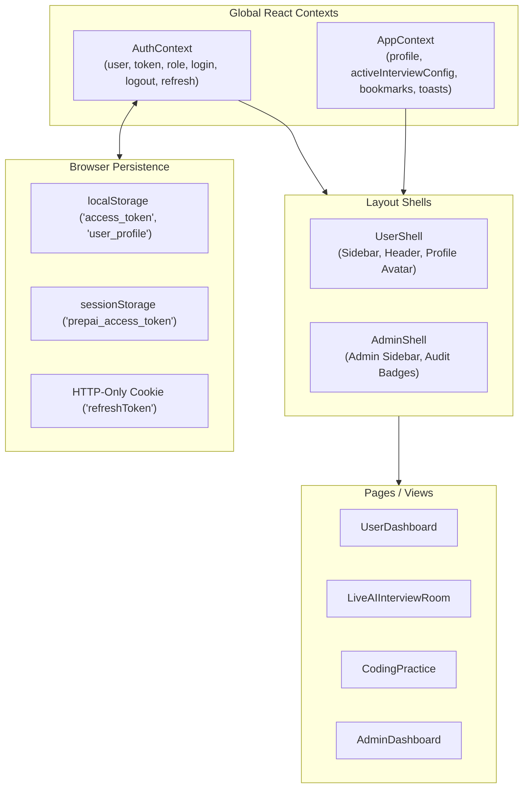

# 02 — Frontend Architecture & UI Component Design

## 1. Overview & Core Technologies

The PrepAI frontend is an enterprise-grade Single Page Application (SPA) built with:
* **React 18.3.1**: Component-driven architecture using functional components and standard React hooks (`useState`, `useEffect`, `useCallback`, `useMemo`, `useRef`, `useContext`).
* **TypeScript 5.8.2**: Strict type safety across UI models, API payloads, and component props.
* **Vite 5.4.21**: Ultra-fast build tool and development server using ES modules and Rollup bundler.
* **React Router v6 (`react-router-dom` 6.23.1)**: Declarative client-side routing, route protection guards, and nested layout shells.
* **Tailwind CSS 3.4.3**: Utility-first styling with a bespoke design system (light lavender `#F7F7FC` background, subtle dotted grids, elevated `#FFFFFF` cards, deep purple `#5145E5` primary accent, and crisp dark navy `#17182B` typography).
* **Lucide React (v0.378.0)**: Modern, clean iconography throughout all views and navigation bars.
* **Monaco Editor (`@monaco-editor/react` 4.7.0)**: Full-featured VS Code-style editor supporting multi-language syntax highlighting, tab switching, and inline execution.

---

## 2. Directory Structure & Organization

```
frontend/stitch_ai_technical_interview_platform/src/
├── App.tsx                     # Top-level composition & Context provider wrappers
├── main.tsx                    # ReactDOM root bootstrap
├── index.css                   # Global CSS, Tailwind directives, dotted grid background
├── components/
│   ├── auth/
│   │   ├── AuthInput.tsx       # Standardized form input with floating label & validation
│   │   ├── AuthLayout.tsx      # Dual-pane card layout for login/register/reset flows
│   │   ├── AuthSelect.tsx      # Custom styled dropdown for branch/semester selection
│   │   ├── AuthStatusBanner.tsx# Feedback banners (success, warning, error)
│   │   ├── PasswordRequirements.tsx # Real-time visual password strength checklist
│   │   └── ProtectedRoute.tsx  # RBAC Route Guard (USER vs ADMIN)
│   ├── coding/
│   │   └── MonacoCodeEditor.tsx# Reusable code editor component with language switcher
│   ├── common/
│   │   ├── QuickFindModal.tsx  # Global Ctrl+K command palette / search modal
│   │   └── Toast.tsx           # Floating toast notification system
│   └── layout/
│       ├── AdminShell.tsx      # Sidebar & top navigation for Administrator Portal
│       └── UserShell.tsx       # Sidebar, breadcrumbs, user menu & QuickFind trigger
├── context/
│   ├── AuthContext.tsx         # User authentication state & token lifecycle
│   └── AppContext.tsx          # Global user preferences, toasts, active interview config
├── pages/                      # 18 Page components (Auth, User & Admin)
├── routes/
│   └── AppRoutes.tsx           # Route definition table & route-shell wrappers
├── services/                   # Modular API service wrappers calling api.ts
└── types/                      # TypeScript declarations for domain entities
```

---

## 3. Application State & Context Architecture



### 3.1 `AuthContext` ([src/context/AuthContext.tsx](file:///c:/major-project/frontend/stitch_ai_technical_interview_platform/src/context/AuthContext.tsx))
* **State Managed:**
  * `user`: Current authenticated user entity (`id`, `email`, `role`, `isEmailVerified`, `profile`, `academicDetails`).
  * `accessToken`: Current active JWT string in memory.
  * `isLoading`: Initial authentication check state (prevents UI flicker on refresh).
  * `isAuthenticated`: Computed boolean (`Boolean(user)`).
  * `isAdmin`: Computed boolean (`user?.role === 'ADMIN'`).
* **Lifecycle & Silent Refresh:**
  * On initial mount, reads cached token from `storageService` or attempts silent refresh via `POST /api/auth/refresh`.
  * If the backend returns a new access token, populates user profile via `GET /api/auth/me`.
  * `login(credentials, rememberMe)`: Dispatches to `authService.login()`, saves token according to `rememberMe` preference (localStorage vs sessionStorage), and hydrates state.
  * `logout()`: Clears memory, removes tokens from web storage, and calls `POST /api/auth/logout` to clear server-side HTTP-only cookies.

### 3.2 `AppContext` ([src/context/AppContext.tsx](file:///c:/major-project/frontend/stitch_ai_technical_interview_platform/src/context/AppContext.tsx))
* **State Managed:**
  * `profile`: Active user profile data (branch, semester, CGPA, target companies, skills).
  * `activeInterviewConfig`: Holds in-progress interview configurations across screens (type, difficulty, topic, branch).
  * `toasts`: Array of active toast notifications with auto-dismiss timers.
  * `showToast(message, type)`: Global helper for success, warning, and error toasts.

---

## 4. Routing & Route Protection

The routing tree in [src/routes/AppRoutes.tsx](file:///c:/major-project/frontend/stitch_ai_technical_interview_platform/src/routes/AppRoutes.tsx) separates public authentication screens from authenticated user and admin workspaces.

### Route Guard: `ProtectedRoute` ([src/components/auth/ProtectedRoute.tsx](file:///c:/major-project/frontend/stitch_ai_technical_interview_platform/src/components/auth/ProtectedRoute.tsx))
* Checks `isAuthenticated` from `AuthContext`.
* If unauthenticated and not loading, redirects to `/login` preserving `location.pathname` in `state.from`.
* If `requiredRole="ADMIN"` is requested and `user.role !== 'ADMIN'`, redirects to `/dashboard` with an access denied warning toast.

### Route Catalog

| Path | Layout Shell | Protection | Target Page Component | Description |
|---|---|---|---|---|
| `/` | Standalone | Public | `LandingPage` | Product landing page, feature highlights, call-to-actions |
| `/login` | `AuthLayout` | Public | `LoginPage` | Student & Admin login with remember-me toggle |
| `/register` | `AuthLayout` | Public | `RegisterPage` | Registration with branch, semester, scholar number inputs |
| `/verify-email` | `AuthLayout` | Public | `VerifyEmailPage` | Token verification from email link & resend triggers |
| `/forgot-password` | `AuthLayout` | Public | `ForgotPasswordPage` | Password recovery initiation via registered email |
| `/reset-password` | `AuthLayout` | Public | `ResetPasswordPage` | Secure password reset with token verification |
| `/dashboard` | `UserShell` | USER | `UserDashboard` | Student overview: quick stats, upcoming sessions, recent progress |
| `/mock-interviews` | `UserShell` | USER | `AIMockInterviewSetup` | 3-Mode interview configuration (Resume, Topic, Comprehensive) |
| `/mock-interviews/live` | `UserShell` | USER | `LiveAIInterviewRoom` | Active verbal AI interview room with real-time scoring |
| `/mock-interviews/live/:id` | `UserShell` | USER | `LiveAIInterviewRoom` | Deep-link to specific active or completed interview session |
| `/interview-history` | `UserShell` | USER | `InterviewHistory` | Chronological session list with score badges & PDF downloads |
| `/coding-practice` | `UserShell` | USER | `CodingPractice` | Monaco IDE, Striver/CP-31 sheets, test-case verification |
| `/company-questions` | `UserShell` | USER | `CompanyQuestions` | Real interview questions by company with difficulty filters |
| `/resources` | `UserShell` | USER | `PreparationResources` | GATE PYQs, VLSI & Core CS cheat sheets, upvoting & downloads |
| `/resume-analyzer` | `UserShell` | USER | `ResumeAnalyzer` | PDF/DOCX drag-and-drop parser, skill extraction & project analysis |
| `/analytics` | `UserShell` | USER | `AnalyticsDashboard` | Radar chart of technical competencies, weekly trends, weak spots |
| `/bookmarks` | `UserShell` | USER | `Bookmarks` | Central repository of bookmarked problems, questions, resources |
| `/profile` | `UserShell` | USER | `UserProfile` | Edit personal info, academic details, branch & semester |
| `/settings` | `UserShell` | USER | `Settings` | Change password, active session monitor, logout all devices |
| `/admin` | `AdminShell` | ADMIN | `AdminDashboard` | Admin portal: user management, moderation, review flags |
| `*` | Standalone | Public | `NotFound` | 404 Error page with navigation shortcuts |

---

## 5. API Service Layer Architecture

All network traffic is routed through a centralized fetch wrapper in [src/services/api.ts](file:///c:/major-project/frontend/stitch_ai_technical_interview_platform/src/services/api.ts).

### Key Architectural Capabilities:
1. **Dynamic Base URL:** Evaluates `import.meta.env.VITE_API_URL` or defaults to `http://localhost:5000/api`.
2. **Automatic Authorization Injection:** Injects `Authorization: Bearer <token>` from memory/storage on all non-public requests.
3. **Cross-Origin Cookie Support:** Always sets `credentials: 'include'` to allow HTTP-only refresh cookies.
4. **Transparent Silent Token Refresh:** If an authenticated request receives an `HTTP 401 Unauthorized`, `api.ts` intercepts the failure, executes `POST /api/auth/refresh`, updates the stored token, and retries the original failed request seamlessly without interrupting the student's session.
5. **Standardized Error Normalization:** Unwraps backend error JSON into typed `ApiError` instances containing HTTP `status`, machine-readable `code`, and field-specific validation errors (`fieldErrors`).
6. **Binary Stream Downloader (`apiDownloadBlob`):** Handles file downloads (such as interview PDF reports and study dossiers) with proper MIME type headers and client-side blob object URL creation.

---

## 6. Page-by-Page Technical Implementation

### 6.1 `LiveAIInterviewRoom.tsx` ([src/pages/LiveAIInterviewRoom.tsx](file:///c:/major-project/frontend/stitch_ai_technical_interview_platform/src/pages/LiveAIInterviewRoom.tsx))
* **Responsibility:** Primary interactive interview room supporting live question answering, answer editing, Socratic hint requests, real-time evaluation rubric updates, completion synthesis, recommendations review, and study notes dossier download.
* **Component State:**
  * `session`: The active `BackendInterviewSession` loaded from the backend.
  * `currentIndex`: Active question pointer (0-indexed).
  * `answerText`: Current response text in the editor.
  * `draftAnswers`: `Record<string, string>` map persisting typed drafts across question navigation so switching questions never clears unsubmitted work.
  * `hintVisible`: Toggle for the examiner's Socratic hint.
  * `activeTab`: Switches between `'overview'` (score breakdown), `'recommendations'` (learning resources), and `'study_notes'` (AI dossier) once completed.
  * `recommendations`: Dynamically fetched from `/api/interviews/sessions/:id/recommendations`.
  * `studyNotes`: Cache of generated study dossier from `/api/interviews/sessions/:id/study-notes`.
* **Important Handlers:**
  * `handleAnswerChange(val)`: Synchronizes both `answerText` and `draftAnswers[currentQuestion.id]`.
  * `handleSubmitAnswer()`: Submits answer to backend; updates rubric metrics live; if Gemini generated a follow-up probe, seamlessly inserts it immediately after the current question.
  * `handleCompleteInterview()`: Calls `interviewService.completeInterview(session.id)`, computing final scores and transitioning the session to `COMPLETED`.
  * `handleDownloadPdf()`: Downloads the compiled interview report PDF.
  * `handleGenerateNotes(regenerate)`: Triggers Gemini to synthesize a personalized technical study dossier.
  * `handleDownloadNotesPdf()`: Downloads the compiled study notes PDF dossier.

### 6.2 `AIMockInterviewSetup.tsx` ([src/pages/AIMockInterviewSetup.tsx](file:///c:/major-project/frontend/stitch_ai_technical_interview_platform/src/pages/AIMockInterviewSetup.tsx))
* **Responsibility:** Pre-interview configuration hub with 3 dedicated interview modes, dynamic sliders, syllabus topic suggestions, and a live session blueprint.
* **Key Features:**
  * **3 Modes:** `RESUME_BASED`, `TOPIC_BASED`, `COMPREHENSIVE`.
  * **Category Sliders:** In `COMPREHENSIVE` mode, users configure question distribution across DSA, System Design/Projects, Core CS, OOP, and Modern Tech (up to 15 questions).
  * **Syllabus Suggestions:** Suggests branch-specific core topics (e.g., Digital VLSI for ECE, Power Electronics for EE, Concurrency for CSE).
  * **Session Blueprint:** Sticky sidebar card providing a real-time summary of expected rigor, question volume, category ratios, and attached resume.

### 6.3 `CodingPractice.tsx` ([src/pages/CodingPractice.tsx](file:///c:/major-project/frontend/stitch_ai_technical_interview_platform/src/pages/CodingPractice.tsx))
* **Responsibility:** Full-screen coding workspace featuring problem selection (Striver A2Z DSA sheet, CP-31), difficulty filters, Monaco code editor, test case preview, and remote compilation.
* **Component State:**
  * `selectedProblem`: Active `CodingProblem` entity.
  * `language`: Current programming language (`cpp`, `python`, `java`, `javascript`, `go`).
  * `code`: Source code written by the student.
  * `executionResult`: Execution metrics (stdout, stderr, runtime, memory, verdict).
* **Key Handlers:**
  * `handleRun()`: Submits code against sample input via `POST /api/coding/problems/:id/run` to test logic quickly without affecting solved stats.
  * `handleSubmit()`: Submits code against hidden judge test cases via `POST /api/coding/problems/:id/submit`, recording an official `ACCEPTED` or error submission in the database.
  * `handleToggleSolved()`: Manually toggle problem completion status.

### 6.4 `ResumeAnalyzer.tsx` ([src/pages/ResumeAnalyzer.tsx](file:///c:/major-project/frontend/stitch_ai_technical_interview_platform/src/pages/ResumeAnalyzer.tsx))
* **Responsibility:** Drag-and-drop resume upload portal supporting PDF and DOCX files.
* **Features:**
  * Uses `FormData` to send multipart file upload to `POST /api/resumes/analyze`.
  * Renders parsed resume summary, extracted skills pills, detected projects with technical challenges, and AI suggestions.
  * Provides a direct button: *"Start Resume-Personalized Mock Interview"*, bridging the parsed profile into the interview room.

### 6.5 `AdminDashboard.tsx` ([src/pages/AdminDashboard.tsx](file:///c:/major-project/frontend/stitch_ai_technical_interview_platform/src/pages/AdminDashboard.tsx))
* **Responsibility:** Operational center for system administrators.
* **Tabs & Sub-modules:**
  1. **Overview & Analytics:** Real-time platform counts (total users, completed interviews, average placement score, active flags).
  2. **User Management:** Searchable user directory, role switching (`USER` $\leftrightarrow$ `ADMIN`), active status toggling.
  3. **Resource Requests:** Table of student-requested books/notes with `APPROVED` / `REJECTED` action buttons.
  4. **AI Review Flags:** Candidate-flagged interview evaluations requiring administrative audit, with resolution notes and status updates (`RESOLVED`, `DISMISSED`).
  5. **Coding Problem Manager:** CRUD modal to create and edit coding problems, test cases, and difficulty ratings.
  6. **Interview Audit:** Inspect any student's interview session, evaluations, and Gemini socratic logs.
