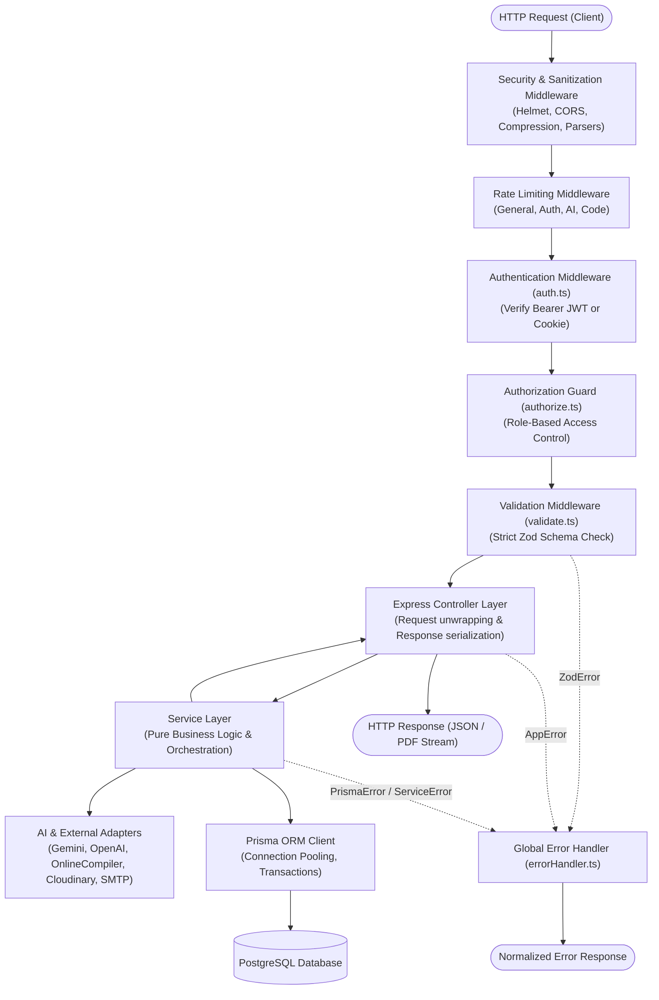

# 03 — Backend Architecture & Service Layer Design

## 1. Overview & Layered Pattern

The PrepAI backend is designed as a **Layered Modular Architecture** implemented in Node.js with Express 4 and TypeScript. Every inbound HTTP request travels through a predictable, secure, and isolated execution path:



---

## 2. Server Lifecycle & Bootstrap

### 2.1 Server Bootstrap ([src/server.ts](file:///c:/major-project/backend/src/server.ts))
* **Database Connection Verification:** Runs `await prisma.$connect()` upon startup to ensure database connectivity before accepting incoming socket connections.
* **SMTP Transporter Verification:** If `serviceStatus.hasSmtp` is true, calls `verifyMailTransporter()` asynchronously to verify Gmail SMTP credentials (`smtp.gmail.com:587`, STARTTLS) and logs diagnostic readiness.
* **Dynamic Port Binding:** Binds Express to `env.port` (`process.env.PORT` or default `5000`), enabling plug-and-play compatibility with cloud container environments (such as Render, Railway, AWS ECS).
* **Graceful Shutdown:** Hooks into `process.on('SIGINT')` and `process.on('SIGTERM')`. When a termination signal is received:
  1. Stops accepting new inbound HTTP connections (`server.close()`).
  2. Disconnects Prisma database connection pool (`await prisma.$disconnect()`).
  3. Exits cleanly with status code `0`.

### 2.2 Express Pipeline Configuration ([src/app.ts](file:///c:/major-project/backend/src/app.ts))
1. **Security Headers (`helmet`):** Configures HTTP security headers with `crossOriginResourcePolicy: { policy: 'cross-origin' }` to allow authenticated client fetch and blob downloads.
2. **Dynamic CORS (`cors`):** 
   * Reads comma-separated `CLIENT_URL` values.
   * Strips trailing slashes from both allowed origins and incoming `requestOrigin`.
   * Enables `credentials: true` for cross-site cookie transmission.
3. **Response Compression (`compression`):** Gzip/Deflate compression for all JSON and text payloads exceeding 1 KB.
4. **Body Parsers (`express.json`, `express.urlencoded`):** Configured with a `1mb` safety limit to prevent denial-of-service memory exhaustion.
5. **Cookie Parser (`cookie-parser`):** Parses signed/unsigned cookies, enabling extraction of `refreshToken` and `accessToken`.
6. **HTTP Request Logging (`morgan`):** Formats output using `'dev'` in development and `'combined'` (Apache-style with IP and User-Agent) in production.
7. **Global API Rate Limiting:** Mounts `generalRateLimiter` on `/api` (300 requests / 15 minutes).
8. **Health Check Endpoint:** `GET /api/health` returns runtime uptime and boolean status of all third-party integrations (`hasGemini`, `hasOpenAi`, `hasOnlineCompiler`, `hasCloudinary`, `hasSmtp`).
9. **Modular Route Registry:** Mounts the 11 domain route sub-routers.
10. **Error Trapping:** Unhandled routes cascade to `notFoundHandler`; all thrown errors bubble to `errorHandler`.

---

## 3. Middleware Catalog

### 3.1 Authentication: `authenticate` & `optionalAuthenticate` ([src/middleware/auth.ts](file:///c:/major-project/backend/src/middleware/auth.ts))
* **Token Extraction Strategy:**
  1. Checks `Authorization: Bearer <token>` header.
  2. If missing, checks `req.cookies.accessToken`.
* **Verification:** Calls `verifyAccessToken(token)`. If valid, attaches the decoded payload `{ userId, email, role }` to `req.user`.
* **Failure Modes:** Throws `UnauthorizedError('Authentication token is missing or malformed.')` or `UnauthorizedError('Invalid or expired authentication token.')`.
* **`optionalAuthenticate`:** Extracts and verifies the token if provided, but does not throw if absent. Used for public listings that personalize metadata (such as bookmark status or solved flags) when a user happens to be logged in.

### 3.2 Authorization: `authorize` ([src/middleware/authorize.ts](file:///c:/major-project/backend/src/middleware/authorize.ts))
* **Role Enforcement:** Accepts one or more `UserRole` enums (e.g. `authorize(UserRole.ADMIN)`).
* **Validation:** Verifies that `req.user` exists and `allowedRoles.includes(req.user.role)`.
* **Security Guard:** If a normal `USER` tries to access admin routes (`/api/admin/*`, `POST /api/company-questions`, etc.), rejects immediately with `ForbiddenError('You do not have permission to perform this action.')`.

### 3.3 Request Validation: `validate` ([src/middleware/validate.ts](file:///c:/major-project/backend/src/middleware/validate.ts))
* **Type-Safe Validation:** Wraps any Zod schema: `validate(schema, 'body' | 'query' | 'params')`.
* **Error Formatting:** Parses Zod validation issues into a clean `Record<string, string>` map of field names to human-readable error messages.
* **Error Bubbling:** Throws a `BadRequestError(firstErrorMessage, formattedFieldErrors)`.

### 3.4 Rate Limiters ([src/middleware/rateLimiter.ts](file:///c:/major-project/backend/src/middleware/rateLimiter.ts))
* **`generalRateLimiter`:** 300 requests per 15 minutes across all `/api` endpoints.
* **`authRateLimiter`:** 15 requests per 15 minutes for `/api/auth/login`, `/register`, `/forgot-password`, preventing credential stuffing and brute-force attacks.
* **`aiRateLimiter`:** 25 requests per 10 minutes for Gemini interview sessions, evaluation submissions, and resume analysis to protect API quotas.
* **`codeExecutionRateLimiter`:** 20 requests per 5 minutes for `/api/coding/problems/:id/run` and `/submit` to prevent remote execution abuse.

### 3.5 File Uploads: `resumeUpload` ([src/middleware/upload.ts](file:///c:/major-project/backend/src/middleware/upload.ts))
* **Storage Engine:** `multer.memoryStorage()` keeps files in RAM buffer for immediate text parsing and Cloudinary stream piping.
* **File Size Cap:** `5 * 1024 * 1024` (Strict 5 MB limit).
* **MIME Filter:** Rejects anything other than `application/pdf`, `application/msword`, and `application/vnd.openxmlformats-officedocument.wordprocessingml.document`.

### 3.6 Central Error Handler ([src/middleware/errorHandler.ts](file:///c:/major-project/backend/src/middleware/errorHandler.ts))
Normalizes all exceptions into a standard JSON payload:
```json
{
  "error": {
    "message": "Human readable error description",
    "code": "BAD_REQUEST | UNAUTHORIZED | NOT_FOUND | SERVICE_UNAVAILABLE",
    "status": 400,
    "fieldErrors": { "fieldName": "Specific issue description" },
    "stack": "Included only in non-production environments"
  }
}
```
Specialized handlers exist for:
* `AppError` subclasses.
* `ZodError` validation failures.
* Prisma errors:
  * `P2002` (Unique constraint violated $\rightarrow$ `ConflictError`).
  * `P2025` (Record not found $\rightarrow$ `NotFoundError`).
* Generic uncaught exceptions (`500 Internal Server Error`).

---

## 4. Custom Error Hierarchy ([src/utils/errors.ts](file:///c:/major-project/backend/src/utils/errors.ts))

All business errors inherit from `AppError`:

```typescript
export class AppError extends Error {
  constructor(
    message: string,
    public statusCode = 500,
    public code = 'INTERNAL_ERROR',
    public fieldErrors?: Record<string, string>
  ) {
    super(message);
    this.name = this.constructor.name;
    Error.captureStackTrace(this, this.constructor);
  }
}

export class BadRequestError extends AppError {
  constructor(message = 'Invalid request payload.', fieldErrors?: Record<string, string>) {
    super(message, 400, 'BAD_REQUEST', fieldErrors);
  }
}

export class UnauthorizedError extends AppError {
  constructor(message = 'Authentication required.') {
    super(message, 401, 'UNAUTHORIZED');
  }
}

export class ForbiddenError extends AppError {
  constructor(message = 'You do not have access to this resource.') {
    super(message, 403, 'FORBIDDEN');
  }
}

export class NotFoundError extends AppError {
  constructor(message = 'Requested resource was not found.') {
    super(message, 404, 'NOT_FOUND');
  }
}

export class ConflictError extends AppError {
  constructor(message = 'A resource with this identifier already exists.') {
    super(message, 409, 'CONFLICT');
  }
}

export class ServiceUnavailableError extends AppError {
  constructor(message = 'Upstream service is temporarily unavailable.') {
    super(message, 503, 'SERVICE_UNAVAILABLE');
  }
}
```

---

## 5. Domain Services Architecture

The backend isolates all business rules inside dedicated service modules:

| Service File | Domain Responsibility | External Integrations |
|---|---|---|
| `auth.service.ts` | User registration, password verification, token issuance, refresh token rotation, email tokens | Bcrypt, JWT, Nodemailer |
| `interview.service.ts` | 3-mode session orchestration, Gemini question generation, answer upsert, follow-up sequencing, score synthesis | Gemini API, OpenAI, Prisma Transactions |
| `recommendation.service.ts` | Algorithmic gap extraction from evaluation scores & missing concepts, resource/problem mapping | PostgreSQL / Prisma |
| `report.service.ts` | PDFKit report rendering, Gemini study notes synthesis, study notes PDF compilation | PDFKit, Gemini API |
| `resume.service.ts` | PDF/DOCX text extraction, Cloudinary asset upload, Gemini structured resume analysis | `pdf-parse`, `mammoth`, Cloudinary, Gemini |
| `codeExecution.service.ts` | Sandboxed code execution, language mapping, timeout handling, stdout/stderr normalization | OnlineCompiler.io, Judge0 CE |
| `coding.service.ts` | Problem bank querying, progress tracking, multi-test-case judging loop | `codeExecutionService`, Prisma |
| `companyQuestion.service.ts` | Company directory, interview question repository, search and tag filtering | Prisma |
| `resource.service.ts` | Preparation resource compendiums, GATE PYQ tagging, upvoting, student request pipeline | Prisma |
| `bookmark.service.ts` | Unified polymorphic bookmarking for problems, company questions, and resources | Prisma |
| `profile.service.ts` | Candidate profiles, academic branch/semester settings, CGPA and scholar records | Prisma |
| `settings.service.ts` | Security settings, password rotation, multi-device session revocation | Bcrypt, Prisma |
| `admin.service.ts` | Platform analytics, user role moderation, request approvals, AI evaluation review audits | Prisma |
| `analytics.service.ts` | Multi-dimensional competency aggregation, mock interview performance trends | Prisma |
