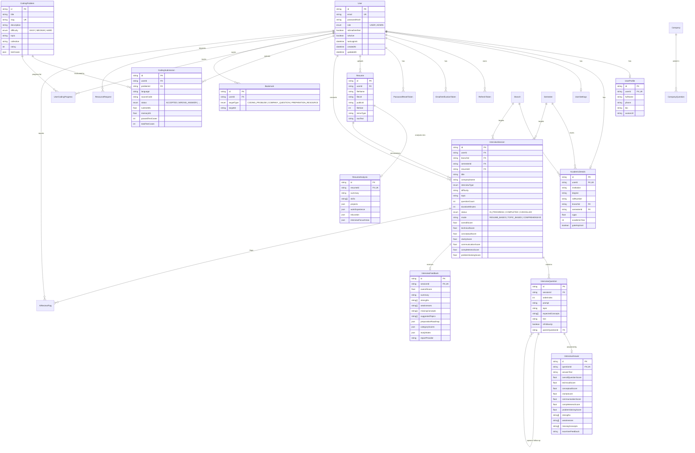

# 06 — Complete Database Architecture & Data Modeling

## 1. Overview & Prisma Configuration

PrepAI utilizes **PostgreSQL** as its relational database management system, managed exclusively through **Prisma ORM (v5.22.0)**. 

### Prisma Datasource & Generator Configuration ([prisma/schema.prisma](file:///c:/major-project/backend/prisma/schema.prisma)):
```prisma
generator client {
  provider = "prisma-client-js"
}

datasource db {
  provider = "postgresql"
  url      = env("DATABASE_URL")
}
```

The database consists of **24 Models** and **8 Enums**, with relational integrity enforced by foreign key constraints and `onDelete: Cascade` rules to ensure that removing a user or session cleanly cascades without leaving orphaned records.

---

## 2. Complete Entity-Relationship (ER) Diagram



---

## 3. Database Models & Field Specifications

### 3.1 User & Identity Domain
1. **`User`**: Base authentication record.
   * `id`: `String @id @default(cuid())`
   * `email`: `String @unique`
   * `passwordHash`: `String` (Bcrypt hash)
   * `role`: `UserRole @default(USER)` (Indexed)
   * `isEmailVerified`: `Boolean @default(false)`
   * `isActive`: `Boolean @default(true)` (Indexed)
2. **`UserProfile`**: One-to-one candidate personal metadata (`fullName`, `phone`, `bio`, `avatarUrl`).
3. **`AcademicDetails`**: One-to-one institutional curriculum configuration:
   * `branchId`: References `Branch.id`
   * `semesterId`: References `Semester.id`
   * `institution`: e.g. "MANIT Bhopal"
   * `degree`: e.g. "B.Tech"
   * `cgpa`: `Float?`
   * `gateAspirant`: `Boolean @default(false)`
4. **`UserSettings`**: Study preferences (`theme`, `preferredDifficulty`, `emailNotifications`, `interviewReminders`).
5. **`RefreshToken`**: Active sessions tracking (`tokenHash @unique`, `userId`, `userAgent`, `ipAddress`, `expiresAt`).
6. **`EmailVerificationToken` & `PasswordResetToken`**: Secure time-limited tokens with unique compound index on `[userId, token]`.

---

### 3.2 AI Mock Interview Domain
1. **`InterviewSession`**:
   * Master record representing a mock interview loop.
   * `status`: `InterviewStatus` (`IN_PROGRESS`, `COMPLETED`, `CANCELLED`).
   * `mode`: `String? @default("TOPIC_BASED")` (`RESUME_BASED`, `TOPIC_BASED`, `COMPREHENSIVE`).
   * Metrics: `overallScore`, `technicalScore`, `conceptualScore`, `clarityScore`, `communicationScore`, `completenessScore`, `problemSolvingScore`.
   * Relations: `user`, `branch`, `semester`, `resume`, `questions`, `feedback`, `aiReviewFlags`.
2. **`InterviewQuestion`**:
   * Individual question generated by Gemini.
   * `orderIndex`: Sequential ordering (1, 2, 3...).
   * `prompt`, `topic`, `expectedConcepts` (`String[]`), `hint`.
   * `isFollowUp`: `Boolean @default(false)`.
   * `parentQuestionId`: Self-referential foreign key for follow-up questions linked to original parent questions.
3. **`InterviewAnswer`**:
   * `questionId`: `String @unique` (One-to-one with question).
   * `answerText`: Candidate's written explanation.
   * Evaluated Rubric Scores (0-100): `overallQuestionScore`, `technicalScore`, `conceptualScore`, `clarityScore`, `communicationScore`, `completenessScore`, `problemSolvingScore`.
   * Insights: `strengths` (`String[]`), `weaknesses` (`String[]`), `missingConcepts` (`String[]`), `examinerFeedback` (`String`).
4. **`InterviewFeedback`**:
   * Final report card attached to completed session.
   * `preparationRoadmap`: `Json` containing phased weekly milestone tasks.
   * `categoryScores`: `Json` containing domain breakdown (DSA, Systems, Architecture, Core CS).
   * `studyNotes`: `Json` caching the synthesized Technical Mastery Dossier.
   * `reportProvider`: Provider tag (`"openai"`, `"gemini"`, or `"deterministic"`).

---

### 3.3 Coding & Execution Domain
1. **`CodingProblem`**:
   * `slug`: Unique slug for URLs (e.g. `lru-cache`, `two-sum`).
   * `collection`: Source collection (`"Striver A2Z"`, `"CP-31"`).
   * `testCases`: `Json` array containing sample and hidden judge inputs/expected outputs.
2. **`CodingSubmission`**:
   * Records every code submission evaluated by the judge.
   * `status`: `SubmissionStatus` enum (`ACCEPTED`, `WRONG_ANSWER`, `TIME_LIMIT_EXCEEDED`, `COMPILATION_ERROR`, etc.).
   * Performance: `runtimeMs`, `memoryKb`, `passedTestCases`, `totalTestCases`.
3. **`UserCodingProgress`**:
   * Tracks per-user, per-problem auto-saved drafts and solved status:
   * Compound index: `@@unique([userId, problemId])`.

---

### 3.4 Content & Resources Domain
1. **`PreparationResource`**:
   * Curated study material (`title`, `subject`, `format`, `contentUrl`, `isGatePyq`, `upvotes`, `downloads`).
2. **`ResourceRequest`**:
   * Student material requests (`status`: `PENDING`, `APPROVED`, `REJECTED`).
3. **`Company` & `CompanyQuestion`**:
   * Tech companies and interview question archives with company caliber metadata.
4. **`Bookmark`**:
   * Polymorphic bookmarking engine with compound uniqueness constraint:
   * `@@unique([userId, targetType, targetId])`.
5. **`AiReviewFlag`**:
   * Candidate-reported evaluation disputes for administrative moderation.

---

## 4. Database Seeder & Idempotent Migrations

The database includes an idempotent master seeder in [prisma/seed.ts](file:///c:/major-project/backend/prisma/seed.ts) that executes via `npx prisma db push && npm run prisma:seed`:
* **4 Engineering Branches:** Seeded with standard codes (`CSE`, `ECE`, `EE`, `ME`).
* **Semesters 1 through 8:** Seeded with standardized labels.
* **Dedicated Administrator:** Reads `ADMIN_EMAIL` and `ADMIN_PASSWORD` from environment variables, hashes password via Bcrypt, and upserts user with `UserRole.ADMIN`.
* **Companies & Interview Archive:** Seeds Google, Amazon, Microsoft, Flipkart, Uber and real interview questions.
* **Striver A2Z DSA Sheet:** Seeds benchmark algorithmic problems.
* **CP-31 Sheet:** Seeds competitive programming benchmarks with ratings.
* **Preparation Resources:** Seeds GATE PYQs and Core CS cheat sheets.
