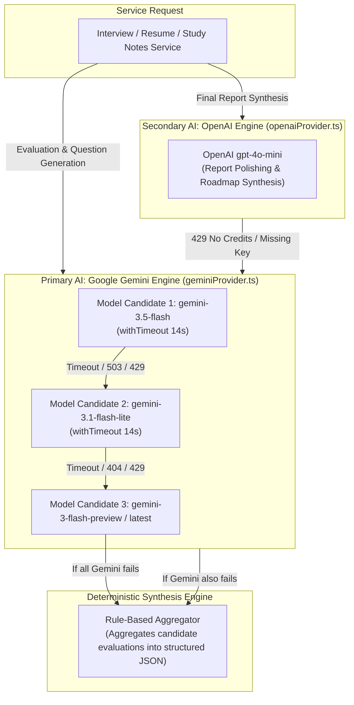

# 07 — AI Integration & Orchestration Architecture

## 1. Overview & Provider Hierarchy

PrepAI employs a dual-provider AI architecture designed for low latency, high technical accuracy, and zero-downtime resilience:



---

## 2. Gemini Engine Implementation ([src/services/ai/geminiProvider.ts](file:///c:/major-project/backend/src/services/ai/geminiProvider.ts))

### 2.1 Model Cascade & Fail-Safe Strategy
The Gemini provider initializes via `@google/generative-ai` with `GEMINI_API_KEY`.
Because individual cloud models occasionally face transient rate spikes (`HTTP 429`) or server load (`HTTP 503`), the engine defines a candidate model cascade:
```typescript
function getModelCandidates(): string[] {
  const models = [
    env.geminiModel, // Defaults to gemini-3.5-flash
    'gemini-3.5-flash',
    'gemini-3.1-flash-lite',
    'gemini-3-flash-preview',
    'gemini-flash-latest',
  ];
  return Array.from(new Set(models.filter(Boolean)));
}
```

### 2.2 Strict Timeout Guard (`withTimeout`)
To prevent hanging HTTP requests from blocking candidate interviews, every AI call is wrapped in a strict 14-second timeout race:
```typescript
function withTimeout<T>(promise: Promise<T>, ms: number, label: string): Promise<T> {
  return new Promise((resolve, reject) => {
    const timer = setTimeout(() => {
      reject(new Error(`Operation timed out after ${ms}ms (${label})`));
    }, ms);
    promise
      .then((res) => { clearTimeout(timer); resolve(res); })
      .catch((err) => { clearTimeout(timer); reject(err); });
  });
}
```

### 2.3 JSON Generation & Schema Validation
All prompts instruct Gemini to output raw, unformatted JSON. The helper `extractAndParseJson` in [aiProvider.ts](file:///c:/major-project/backend/src/services/ai/aiProvider.ts) removes Markdown code fences (````json ... ````), parses the payload, and validates it against strict Zod schemas.

---

## 3. Prompts & AI Workflows

### 3.1 Initial Question Generation (`generateInitialQuestions`)
* **Trigger:** Candidate starts a session in [AIMockInterviewSetup.tsx](file:///c:/major-project/frontend/stitch_ai_technical_interview_platform/src/pages/AIMockInterviewSetup.tsx).
* **Mode Directives:**
  * **`RESUME_BASED`:** Injects candidate's parsed projects, technical skills, and frameworks. Directs Gemini to test architecture decisions, edge cases, and underlying language invariants rather than generic trivia.
  * **`COMPREHENSIVE`:** Injects custom category distribution numbers (DSA, System Design, Core CS, OOP, Technologies) to construct a balanced placement battery.
  * **`TOPIC_BASED`:** Deep-dives into branch curriculum (e.g. OS concurrency, VLSI clock-domain crossing, DBMS indexing).
* **Zod Output Schema:** `generatedQuestionListSchema`:
  ```typescript
  z.array(
    z.object({
      prompt: z.string(),
      topic: z.string(),
      expectedConcepts: z.array(z.string()),
      hint: z.string().optional(),
    })
  )
  ```

---

### 3.2 Live Answer Evaluation & Socratic Follow-Up (`evaluateAnswer`)
* **Trigger:** Candidate clicks "Submit Response" or "Update Answer & Re-evaluate" in [LiveAIInterviewRoom.tsx](file:///c:/major-project/frontend/stitch_ai_technical_interview_platform/src/pages/LiveAIInterviewRoom.tsx).
* **Context Provided to Gemini:**
  1. Engineering discipline, semester, interview type, difficulty.
  2. The question prompt and expected key concepts.
  3. The candidate's written response.
  4. Conversation history of previous questions and candidate answers.
* **Six-Dimensional Rubric:**
  1. **Technical Depth (0-100):** Depth of algorithmic or architectural detail, awareness of invariants, and trade-offs.
  2. **Conceptual Clarity (0-100):** Clear definitions and accurate explanations of underlying mechanisms.
  3. **Structure & Organization (0-100):** Coherent structure and modular explanation flow.
  4. **Communication Precision (0-100):** Concise, professional engineering terminology.
  5. **Completeness (0-100):** Addressing all parts of the question, boundary conditions, and failure modes.
  6. **Problem-Solving Rigor (0-100):** Methodical reasoning and consideration of alternatives.
* **Socratic Follow-Up Generation:**
  If the candidate's answer reveals an incomplete mental model or hints at an optimal invariant without justifying it, Gemini constructs a targeted follow-up question (`followUpQuestion`) to probe deeper, mirroring a real technical examiner.

---

### 3.3 Study Notes & Mastery Dossier Synthesis (`generateStudyNotes`)
* **Trigger:** Post-interview completion in `LiveAIInterviewRoom.tsx` or `GET /api/interviews/sessions/:id/study-notes`.
* **Prompt Engineering:**
  Acts as a Principal Software Engineer and Technical Educator. Inspects the candidate's actual misses, low-scoring dimensions, and examiner feedback, generating:
  * **Executive Summary:** High-level architectural gap diagnosis.
  * **Key Definitions:** Formal definitions with mental-model takeaways.
  * **Core Concepts:** Deep dives into memory layouts, CPU cache interactions, and system invariants.
  * **Algorithms & Patterns:** Clean C++, Python, or Java implementations with time/space complexity bounds.
  * **Critical Interview Q&As:** Ideal senior-engineer responses paired with common candidate pitfalls.
  * **Revision Checklist:** Final pre-interview verification checklist.

---

### 3.4 Resume Parsing & Extraction (`analyzeResume`)
* **Trigger:** Candidate uploads a resume on `/resume-analyzer`.
* **Input:** Raw text extracted by `pdf-parse` or `mammoth`.
* **Prompt Directives:**
  Extracts candidate profile into structured JSON:
  * `summary`: 2-3 sentence technical overview.
  * `skills`: Array of verified technical skills and libraries.
  * `projects`: Array of projects with `name`, `technologies`, `description`, `architectureHighlights`, and `challengingAspects`.
  * `workExperience`: Array of roles, employers, durations, and key achievements.
  * `education`: Degrees, institutions, and graduation years.
  * `interviewFocusAreas`: Suggested questions for the technical interview examiner.
