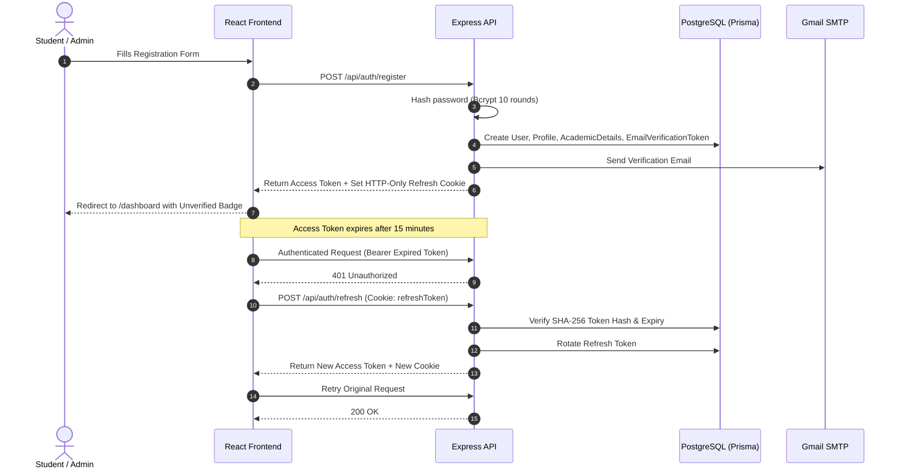

# 08 — Authentication, Authorization & Security Architecture

## 1. Authentication Lifecycle & Token Architecture

PrepAI implements an industry-standard dual-token authentication system designed for both security and seamless user experience:

### 1.1 Token Specifications

| Token Type | Lifespan | Storage Medium | Payload Content | Revocation Strategy |
|---|---|---|---|---|
| **Access Token** | 15 Minutes | In-Memory / Web Storage | `{ userId, email, role }` | Expires naturally after 15 minutes |
| **Refresh Token** | 7 Days | HTTP-Only Cookie (`refreshToken`) | `{ userId, tokenId }` | Revoked on logout, password change, or `logoutAllDevices()` |
| **Email Verification Token** | 24 Hours | Stored in PostgreSQL | Cryptographic random hex | Deleted immediately upon successful verification |
| **Password Reset Token** | 1 Hour | Stored in PostgreSQL | Cryptographic random hex | Deleted immediately upon password reset; invalidates all refresh tokens |

---

## 2. Password Hashing & Cryptographic Invariants

* **Algorithm:** `bcryptjs` utilizing **10 salt rounds** in [src/utils/password.ts](file:///c:/major-project/backend/src/utils/password.ts).
* **Work Factor:** 10 rounds provides strong protection against GPU-accelerated dictionary and rainbow table attacks while maintaining low CPU latency (~60ms) on modern server CPUs.
* **Token Hashing:** Refresh tokens are never stored in plaintext. They are hashed using `crypto.createHash('sha256').update(rawToken).digest('hex')` in [src/utils/jwt.ts](file:///c:/major-project/backend/src/utils/jwt.ts). Even in the unlikely event of a database compromise, attacker cannot forge refresh cookies.

---

## 3. Role-Based Access Control (RBAC)

The platform enforces two distinct privilege tiers via the `UserRole` enum:

1. **`USER` (Students & Engineering Candidates):**
   * Can create mock interviews, view their own sessions, run coding problems, upload resumes, and bookmark content.
   * Attempting to access admin routes results in `403 Forbidden`.
2. **`ADMIN` (Platform Instructors & Moderation Staff):**
   * Full access to `/api/admin/*`.
   * Can review flagged AI evaluations, approve/reject student resource requests, manage coding problem test cases, and inspect institutional placement metrics.

### Enforcement Layers:
* **Backend Enforcement:** Guarded by `authenticate` followed by `authorize(UserRole.ADMIN)` in [src/middleware/authorize.ts](file:///c:/major-project/backend/src/middleware/authorize.ts).
* **Frontend Enforcement:** Guarded by `ProtectedRoute` with `requiredRole="ADMIN"` in [src/components/auth/ProtectedRoute.tsx](file:///c:/major-project/frontend/stitch_ai_technical_interview_platform/src/components/auth/ProtectedRoute.tsx) wrapping `<AdminShell>`.

---

## 4. Comprehensive Security Audit & Threat Defenses

### 4.1 SQL Injection Defense
* **Risk:** Attacker injects arbitrary SQL syntax through inputs (`topic`, `email`, `search`).
* **Defense:** PrepAI uses **Prisma ORM** for all database queries. Prisma generates parameterized, type-safe SQL statements where all dynamic inputs are treated strictly as query parameters, rendering standard SQL injection attacks impossible.

### 4.2 Cross-Site Scripting (XSS) Defense
* **Risk:** Attacker injects malicious `<script>` tags into candidate explanations or problem solutions.
* **Defenses:**
  * React automatically escapes all dynamic text rendered inside JSX expressions (`{text}`).
  * Sensitive refresh tokens are stored in `httpOnly` cookies that JavaScript cannot access via `document.cookie`.
  * `helmet()` adds Content-Security-Policy headers and prevents iframe clickjacking.

### 4.3 Cross-Site Request Forgery (CSRF) Defense
* **Defenses:**
  * Primary state-changing requests require the `Authorization: Bearer <token>` header, which browsers never attach automatically to cross-origin requests.
  * For refresh cookie requests, `sameSite: (env.isProduction ? 'none' : 'lax')` and `secure: env.isProduction` ensure cookies are sent only via HTTPS over verified CORS origins.

### 4.4 Brute-Force & Denial of Service (DoS) Defenses
* **Rate Limiting:**
  * `authRateLimiter`: 15 requests / 15 minutes for `/login`, `/register`, `/forgot-password`.
  * `aiRateLimiter`: 25 requests / 10 minutes for interview generation and resume analysis.
  * `codeExecutionRateLimiter`: 20 requests / 5 minutes for remote code execution.
* **Payload Size Limits:** `express.json({ limit: '1mb' })` and Multer memory caps at `5MB`.

### 4.5 Safe File Uploads
* Files uploaded via `/api/resumes/analyze` are processed in memory (`multer.memoryStorage()`).
* MIME type validation rejects executable binaries, scripts, or non-document formats.
* Document text is extracted safely via `pdf-parse` and `mammoth` in isolated memory contexts before being uploaded to Cloudinary.
