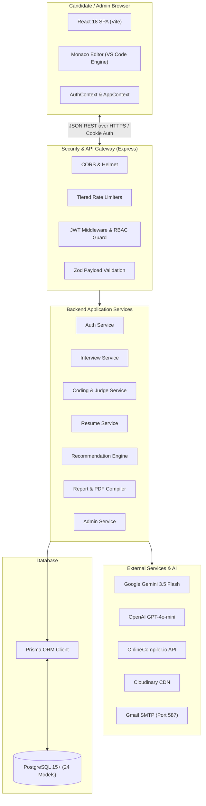
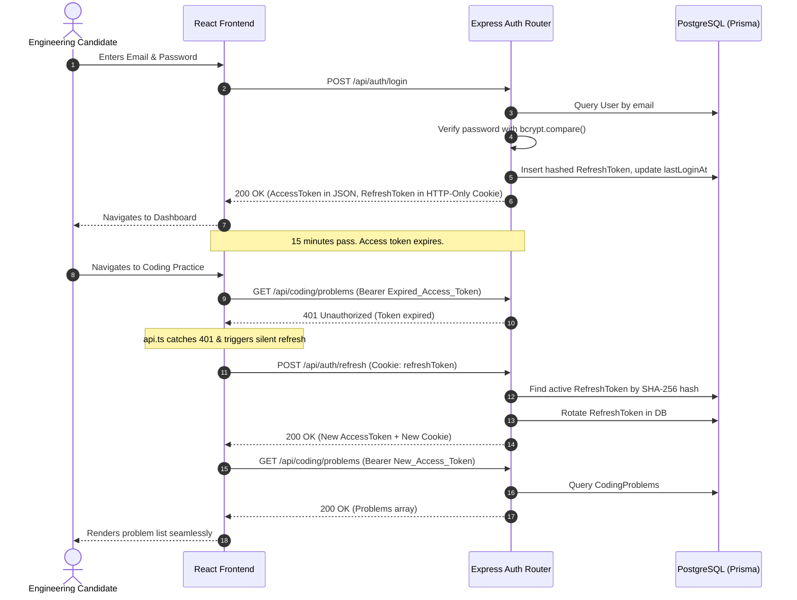
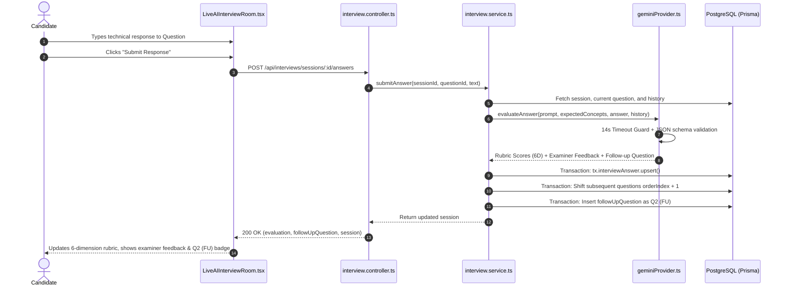
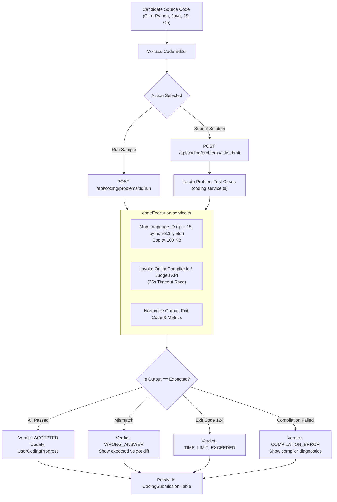
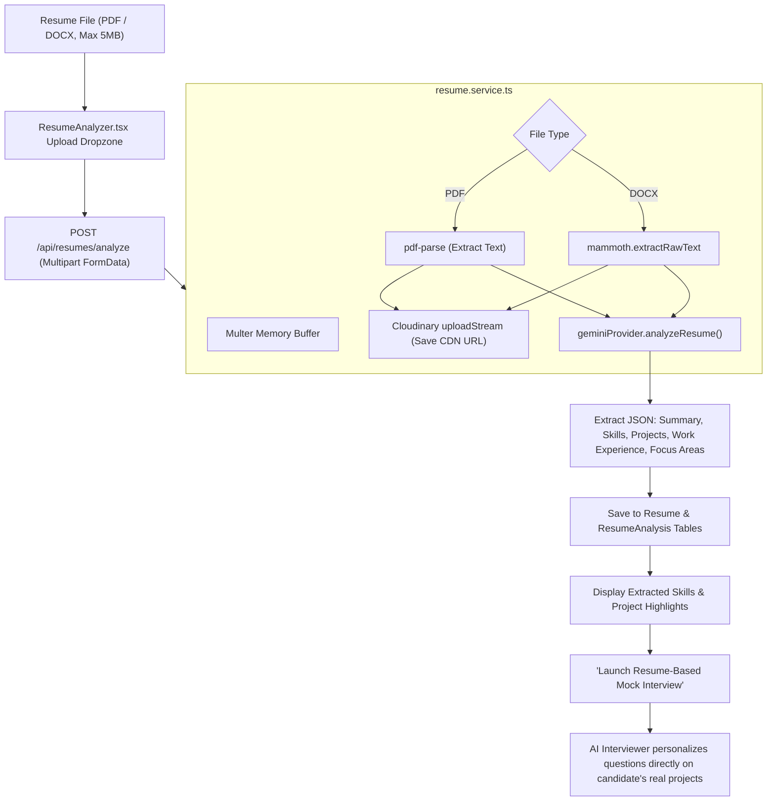
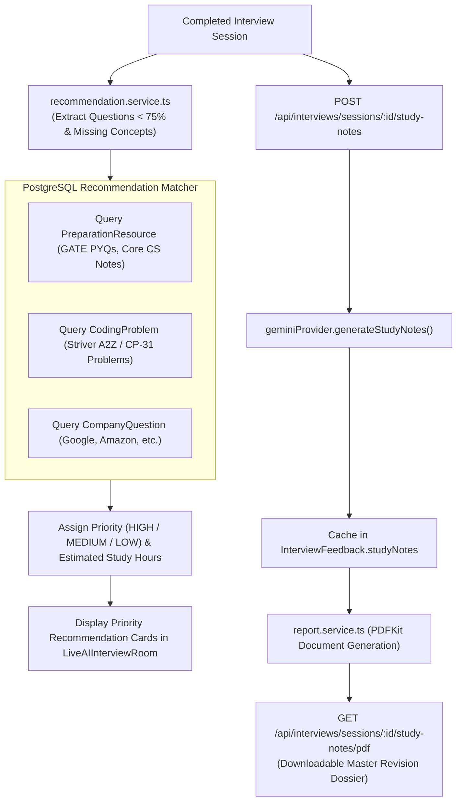

# 10 — System Architecture & Sequence Diagrams

This document contains architectural blueprints and execution sequence diagrams representing the actual implemented flows in PrepAI.

---

## 1. High-Level Full-Stack System Architecture

---

## 2. Authentication & Silent Refresh Sequence

---

## 3. AI Mock Interview & Follow-up Loop Sequence

---

## 4. Multi-Language Code Execution & Judging Pipeline

---

## 5. Resume Parsing & Personalized Interview Alignment

---

## 6. Post-Interview Remediation & Study Dossier Pipeline

